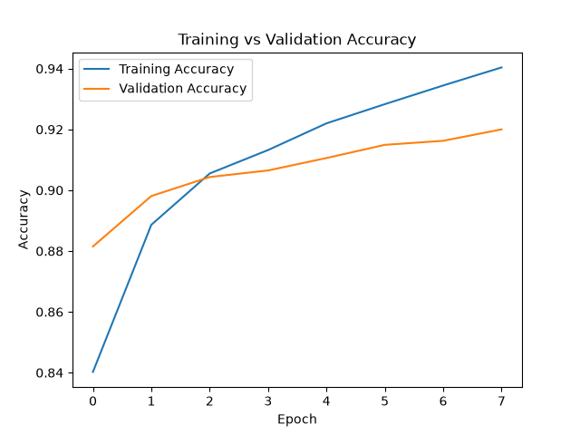
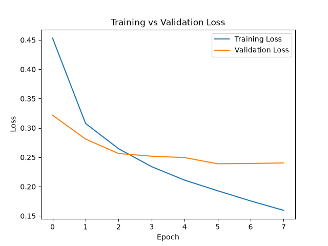
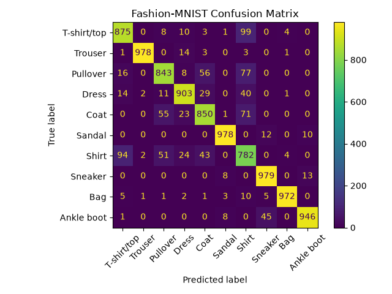

# Fashion-MNIST Image Classifier

A deep learning image classification project built with TensorFlow and Keras.

The project classifies Fashion-MNIST clothing images into 10 categories using both a Dense Neural Network and a Convolutional Neural Network (CNN).

## Project Goal

The goal of this project is to build and evaluate neural network models for multi-class image classification and compare the performance of a Dense Neural Network with a CNN.

## Dataset

Fashion-MNIST contains:

- 60,000 training images
- 10,000 test images
- 28 × 28 grayscale images
- 10 clothing categories

## Classes

1. T-shirt/top
2. Trouser
3. Pullover
4. Dress
5. Coat
6. Sandal
7. Shirt
8. Sneaker
9. Bag
10. Ankle boot

## Models

### Dense Neural Network

Architecture:

- Input: 784 features
- Dense: 128 neurons with ReLU
- Output: 10 neurons with Softmax

Test Accuracy: **87.94%**

### Convolutional Neural Network

Architecture:

- Conv2D: 32 filters, 3 × 3 kernel, ReLU
- MaxPooling2D: 2 × 2
- Flatten
- Dense: 128 neurons with ReLU
- Dropout: 30%
- Output: 10 neurons with Softmax

CNN Test Accuracy: **91.28%**

## Techniques Used

- Image normalization
- Dense Neural Networks
- Convolutional Neural Networks
- ReLU activation
- Softmax activation
- Sparse Categorical Cross-Entropy
- Adam optimizer
- Dropout
- Early Stopping
- Model Checkpointing
- Confusion Matrix
- Precision, Recall and F1-score
- External image inference
- Flask API

## Project Structure

```text
fashion-mnist-classifier/
│
├── src/
│   ├── data_loader.py
│   ├── train.py
│   ├── evaluate.py
│   ├── predict.py
│   ├── cnn_data_loader.py
│   ├── cnn_train.py
│   ├── cnn_evaluate.py
│   ├── cnn_predict.py
│   ├── confusion_matrix.py
│   ├── predict_external.py
│   └── app.py
│
├── models/
│   ├── fashion_mnist_model.keras
│   ├── fashion_mnist_cnn.keras
│   └── best_fashion_mnist_cnn.keras
│
├── outputs/
│   ├── accuracy_plot.png
│   ├── loss_plot.png
│   └── confusion_matrix.png
│
├── requirements.txt
├── .gitignore
└── README.md
```

## Training Performance

### Accuracy



### Loss



## Confusion Matrix



## Classification Report Highlights

Overall accuracy: **91%**

Strongest classes:

- Trouser: F1-score **0.99**
- Sandal: F1-score **0.98**
- Bag: F1-score **0.98**
- Sneaker: F1-score **0.96**
- Ankle boot: F1-score **0.96**

Weakest class:

- Shirt
  - Precision: **0.72**
  - Recall: **0.78**
  - F1-score: **0.75**

The model performs very well on visually distinct classes such as Trouser, Sandal, and Bag.

Shirt is the most difficult class because it is visually similar to classes such as T-shirt/top, Pullover, and Coat.

## External Image Prediction

The project can also make predictions on custom image files.

Run:

```powershell
python src/predict_external.py
```

Before prediction, the image is:

- converted to grayscale
- resized to 28 × 28 pixels
- normalized to values between 0 and 1
- reshaped to `(1, 28, 28, 1)`

The model then outputs the predicted clothing class and confidence score.

Real-world product images can produce lower-confidence predictions because Fashion-MNIST contains simple grayscale images. This difference between training data and real-world images is known as **domain shift**.

## Flask Prediction API

The trained CNN can also be served through a Flask API.

Start the API:

```powershell
python src/app.py
```

The API runs locally at:

```text
http://127.0.0.1:5000
```

### Health Endpoint

```text
GET /health
```

Example response:

```json
{
  "status": "ok"
}
```

### Prediction Endpoint

```text
POST /predict
```

Send an image using:

```powershell
curl.exe -X POST -F "file=@sample_image.png" http://127.0.0.1:5000/predict
```

Example response:

```json
{
  "confidence": 52.64,
  "predicted_class": "Shirt"
}
```

The API performs the required image preprocessing before sending the image to the CNN model.

It also validates uploaded files and returns a `400 Bad Request` response when an invalid image is provided.

## Model Evaluation

The CNN is evaluated using:

- Accuracy
- Precision
- Recall
- F1-score
- Confusion Matrix

The confusion matrix helps identify which Fashion-MNIST classes are most frequently confused with each other.

One of the most common errors observed was:

```text
T-shirt/top → Shirt
```

This happens because these two clothing categories have similar visual features.

## Key Learnings

This project demonstrates:

- preprocessing image datasets
- building Dense Neural Networks
- building Convolutional Neural Networks
- using convolution and pooling layers
- preventing overfitting using Dropout
- using Early Stopping
- saving the best model using ModelCheckpoint
- evaluating multiclass models
- analyzing confusion matrices
- calculating Precision, Recall and F1-score
- loading saved models for inference
- predicting custom images
- understanding domain shift
- exposing a deep learning model through a Flask API
- handling invalid API input

## Technologies

- Python
- TensorFlow
- Keras
- NumPy
- Matplotlib
- scikit-learn
- Pillow
- Flask
